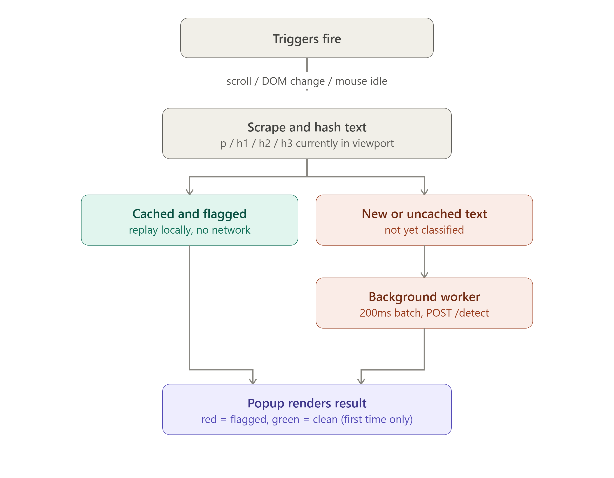

<p align="center">
  
</p>

<h1 align="center">Dagent</h1>
<p align="center"><b>The web has secrets. We find them.</b><br>
A two-stage (plus optional third-stage) ML agent that detects dark patterns on any website, down to the exact sentence.</p>

---

## Contents

1. [Project status (read this first)](#1-project-status-read-this-first)
2. [What is Dagent?](#2-what-is-dagent)
3. [How it works](#3-how-it-works)
4. [Dataset](#4-dataset)
5. [Models and training](#5-models-and-training)
6. [Backend (FastAPI)](#6-backend-fastapi)
7. [Browser extension](#7-browser-extension)
8. [Frontend website](#8-frontend-website)
9. [Repository map](#9-repository-map)
10. [Getting started](#10-getting-started)
11. [Known limitations](#11-known-limitations)
12. [Roadmap](#12-roadmap)
13. [Further reading](#13-further-reading)

---

## 1. Project status (read this first)

> **The live detection model has not been deployed.**
> The trained models are large, and the project did not have the funding needed to host them.

- The **frontend** is a demonstration of the product idea. Its scan preview uses prepared examples and simulated results. It does **not** scan the website you are visiting and does **not** call the detection API.
- The **API** and **extension** are working prototypes. To run them you must download the model files separately (see [Getting started](#10-getting-started)).
- The longer-term goal is to shrink the models and find a sustainable way to run them, ideally fully on-device.

| Component | Status |
|---|---|
| Dataset (2,356 labelled examples) | Done |
| Two-stage DistilBERT training notebook | Done |
| FastAPI backend (`/health`, `/detect`) | Prototype, works locally with model files |
| Stage 3 LLM verification (Groq) | Prototype, optional, fails open |
| Chrome (Manifest V3) extension | Prototype, targets `http://localhost:8000` |
| Frontend website + simulated scan demo | Demo only |
| Hosted / deployed model | Not deployed |
| On-device (ONNX / in-browser) mode | Planned |

---

## 2. What is Dagent?

Websites often use manipulative design and copy to steer people into choices they did not mean to make: fake urgency ("Sale ends in 5 minutes!"), false scarcity ("Only 2 left!"), fabricated social proof ("14 people are viewing this"), confirmshaming, hidden costs, forced continuity, and misdirection.

Dagent explores how a browser tool could help people spot this as they browse. It is designed to:

- Read the page **as the user actually scrolls it**, not just a one-time snapshot.
- Classify text at **sentence level**, even inside long paragraphs.
- Return **which exact sentence** triggered a detection, its **category**, and a **confidence score**.
- Stay cheap enough to run continuously by using a **cascade**, so only suspicious text reaches the more expensive stages.
- Work on the **whole web**, not just shopping carts (for example, a streaming trial that quietly auto-renews, or a newsletter popup that keeps reappearing).

### Dark pattern categories

| Category | Example | Labelled examples |
|---|---|---|
| Scarcity | "Only 2 left in stock!" | 418 |
| Social Proof | "14 people are viewing this item." | 312 |
| Urgency | "Offer ends in 04:59." | 210 |
| Misdirection | "No thanks, I like paying full price." | 195 |
| Obstruction | "To cancel, call support 9-5 on weekdays." | 27 |
| Sneaking | "Priority insurance has been added to your cart." | 12 |
| Forced Action | "Create an account to continue checkout." | 4 |

---

## 3. How it works

Dagent is a cascade. Each stage is more expensive than the last, and each one only sees what the previous stage flagged.

```
Scraped text block
      |
      v
spaCy sentence segmentation
      |
      v
Stage 1  "The Lookout"        DistilBERT binary classifier   (every sentence)
      |  flagged only
      v
Stage 2  "The Profiler"       DistilBERT category classifier (flagged sentences)
      |  candidates only
      v
Stage 3  "The Interrogator"   Groq LLM verification          (optional, one call per request)
      |
      v
confirmed -> shown (red)   partial -> shown (orange) + reasoning   rejected -> removed + logged
```

| Stage | Model | Question it answers | Runs on |
|---|---|---|---|
| 1 | `distilbert-base-uncased`, fine-tuned | Is this sentence a dark-pattern candidate? | Every sentence |
| 2 | `distilbert-base-uncased`, fine-tuned (class-weighted) | Which category is it? | Stage 1 positives only |
| 3 | Groq-hosted LLM (optional) | Is this candidate genuinely a dark pattern? | Stage 1 + 2 candidates only |

Stage 3 is **fail-open**: if no Groq key is configured, the request fails, times out, or the response cannot be parsed, detections are marked `unverified` and still shown rather than silently disappearing. Rejected detections are logged to `data/rejected_detections.jsonl` as future retraining data.

### Architecture options that were considered

| Approach | Idea | Verdict |
|---|---|---|
| A. Extension to LLM directly | Fastest to prototype, but one LLM call per scrape is too costly and slow | Proof of concept only |
| B. Own model, then LLM only if flagged (cascade) | Cheap first pass, LLM only for ambiguous cases | **Selected** |
| C. Fully on-device | Same models exported to ONNX and run in-browser (`transformers.js` / `onnxruntime-web`) so no browsing data leaves the device | Planned (v2) |

---

## 4. Dataset

**File:** `dagent_dataset.csv` (cleaned and merged)

| Column | Type | Description |
|---|---|---|
| `page_id` | int | Source page the snippet came from |
| `text` | string | The scraped sentence, phrase or paragraph |
| `label` | int (0/1) | 1 = dark pattern, 0 = not |
| `Pattern Category` | string | Category (meaningful when `label == 1`; otherwise `Not Dark Pattern`) |

- **2,356 rows** across **1,248 unique pages** (some pages contribute up to 41 rows).
- **Balanced binary labels:** 1,178 positive and 1,178 negative.
- **Imbalanced categories** (see the table in [section 2](#dark-pattern-categories)).
- Median text length is 5 words, up to 143 words, so the models must handle both short phrases and full paragraphs.
- No missing values.

---

## 5. Models and training

Training lives in `dagent_training.ipynb` and is designed for **Google Colab** (a T4 GPU is enough). Run all cells top to bottom and upload the dataset when prompted.

**Key design choices**

- **Grouped split by `page_id`** (70 / 15 / 15 train / val / test). Many rows share a page, so a plain random split would leak a page's style across train and test and inflate validation accuracy.
- **Stage 1** fine-tunes `distilbert-base-uncased` on `label` for 4 epochs (lr 2e-5, batch size 16, best model by F1).
- **Stage 2** trains only on `label == 1` rows for 8 epochs, using **inverse-frequency class weights** through a custom `WeightedTrainer`, so rare classes are not simply ignored.
- **Inference helper** in the notebook segments text with spaCy (naive `.split('.')` breaks on "Dr.", "$19.99", "e.g."), runs Stage 1 then Stage 2, and returns detections with true character offsets.
- Both models are saved (with Stage 2's `label_map.json`) and zipped as `dark_pattern_models.zip`.

> Note: current `transformers` versions renamed the `Trainer` argument `tokenizer=` to `processing_class=`. The notebook already uses the new name.

**Defaults:** `BINARY_THRESHOLD = 0.5`, `CATEGORY_THRESHOLD = 0.0`, `MAX_SEQ_LENGTH = 128`. Tune `BINARY_THRESHOLD` on the validation set, not the test set: raise it to reduce false positives, lower it to catch more.

### Model files

The weights are too large for Git. Download them from the [shared Google Drive folder](https://drive.google.com/drive/folders/1RJFFZU4_VKOmU0d6JxKUz0t0DvrIS4ou?usp=sharing).

---

## 6. Backend (FastAPI)

The backend wraps the models behind two endpoints. Models are loaded **once at startup** through FastAPI's `lifespan` handler, never per request.

```
dagent_api/
├── app/
│   ├── main.py          # app, CORS, lifespan model loading, /health, /detect, Stage 3 orchestration
│   ├── inference.py     # DarkPatternDetector: spaCy, tokenizer, Stage 1 + 2, softmax, thresholds
│   ├── config.py        # model paths, thresholds, MAX_SEQ_LENGTH, DEVICE, CORS, Groq settings
│   ├── schemas.py       # Pydantic request/response models
│   └── llm_verifier.py  # Stage 3 Groq verification
├── models/              # model weights (ignored by Git)
│   ├── dark_pattern_stage1_binary/
│   └── dark_pattern_stage2_category/
├── data/
│   └── rejected_detections.jsonl
├── requirements.txt
└── Dockerfile
```

### Endpoints

| Endpoint | Method | Purpose |
|---|---|---|
| `/health` | GET | Reports whether both models are loaded and which device (cpu/cuda) is in use |
| `/detect` | POST | Takes a batch of 1 to 200 text blocks and returns detections per block |

### Request

```json
{
  "page_url": "https://www.example.com/product",
  "viewport_width": 1440,
  "viewport_height": 900,
  "blocks": [
    { "block_id": "dagent-7", "text": "Only 2 left in stock!", "tag": "p" },
    { "block_id": "dagent-8", "text": "Premium Wireless Headphones", "tag": "h1" }
  ]
}
```

### Response

```json
{
  "results": [
    {
      "block_id": "dagent-7",
      "source_text": "Only 2 left in stock!",
      "detections": [
        {
          "sentence": "Only 2 left in stock!",
          "category": "Scarcity",
          "confidence": 0.94,
          "binary_confidence": 0.97,
          "start_offset": 0,
          "end_offset": 22,
          "llm_verdict": "confirmed",
          "llm_reasoning": null,
          "display_color": "red"
        }
      ]
    },
    { "block_id": "dagent-8", "source_text": "Premium Wireless Headphones", "detections": [] }
  ],
  "total_detections": 1
}
```

An empty `detections` list means clean text. Multiple entries mean multiple dark patterns in the same block. The `start_offset` / `end_offset` values let the extension highlight the exact text.

### Configuration

All values are environment-variable configurable (see `app/config.py`): model paths, `BINARY_THRESHOLD`, `CATEGORY_THRESHOLD`, `MAX_SEQ_LENGTH`, `DEVICE`, `ALLOWED_ORIGINS` (lock this to the extension's origin in production), plus the Groq URL, model name, timeout, API key and rejected-log path.

### Technology cheat sheet

| Technology | Role in this project |
|---|---|
| DistilBERT | The model architecture used for Stage 1 and Stage 2 |
| PyTorch | Framework that actually executes the models (TensorFlow and ONNX are **not** used today) |
| Transformers (Hugging Face) | Loads the tokenizer and models |
| SafeTensors | File format that stores the learned weights |
| Tokenizer | Turns sentences into token IDs |
| spaCy | Splits source text into sentences |
| NumPy | Array maths, including the softmax |
| Softmax | Turns raw logits into class probabilities |

For a full walk-through of startup flow, tokenization, truncation, softmax, thresholds and Stage 3, see the [backend learning documentation](dagent_docs/dagents_backend_docs.docx).

---

## 7. Browser extension

A Chrome Manifest V3 extension (`dagent_extension/`). The request/response flow is shown below.

<p align="center">
  
</p>

| Piece | Where it runs | Notes |
|---|---|---|
| `content-script.js` | Every open tab | Scrapes, hashes, caches, renders the popup |
| `classifiedCache` | In-memory `Map` in the content script | Client-side only, never persisted, wiped on refresh |
| `background.js` | Chrome service worker | Owns the network call and 200ms batching |
| FastAPI backend | Local machine (or wherever deployed) | Stateless, unaware that a cache exists |

**Scraping.** Selector `p, h1, h2, h3`. Text under 3 characters is discarded, and only elements **currently visible in the viewport** (non-zero box, not `display:none` / `visibility:hidden` / `opacity:0`) are scraped. Each block is hashed (djb2-style, base-36) for caching and gets a stable `block_id` (`dagent-1`, `dagent-2`, ...).

**Triggers.** All three call `sendBlocksIfAny()`.

| Trigger | Debounce |
|---|---|
| DOM change (`MutationObserver`) | 400ms |
| Scroll | 300ms |
| Mouse idle | 500ms |

**Cache behaviour**

| Scenario | Popup |
|---|---|
| Cache miss, flagged | Red: sentence, category, confidence % |
| Cache miss, clean | Green "No dark pattern detected" (once) |
| Cache hit, flagged, past the 600ms cooldown | Red, replayed locally with no network call |
| Cache hit, flagged, within cooldown | Suppressed |
| Cache hit, clean | Never shown |

Multiple flagged detections cycle one at a time (4 seconds each). The popup is rendered in a **shadow DOM** host so the page's CSS cannot affect it.

**Typical timing.** A first-time classification takes roughly 500-550ms from scroll-stop to popup (300ms scroll debounce + 200ms batch window + ~120ms measured inference). A cache hit takes about 300ms and is bounded only by the trigger's debounce, with zero backend involvement.

| Constant | Value | File |
|---|---|---|
| `MUTATION_DEBOUNCE_MS` | 400ms | `content-script.js` |
| `SCROLL_DEBOUNCE_MS` | 300ms | `content-script.js` |
| `MOUSE_IDLE_MS` | 500ms | `content-script.js` |
| `REPLAY_COOLDOWN_MS` | 600ms | `content-script.js` |
| `TOAST_DISPLAY_MS` | 4000ms | `content-script.js` |
| `MIN_TEXT_LENGTH` | 3 chars | `content-script.js` |
| `BATCH_WINDOW_MS` | 200ms | `background.js` |

The full pin-to-pin walk-through is in the [extension architecture notes](dagent_docs/dagent_architecture_1).

---

## 8. Frontend website

The website (`dagent_frontend_ui/`) introduces the dark-pattern problem, shows the seven categories with examples, explains the cascade, and offers **Download** and **Feedback / File a Report** pages (email verification step, then issue type and description). It supports light and dark themes and is responsive.

The **Scan** screen shows a simulated shopping page. Scroll through it to see sample alerts for low-stock claims, countdowns and cancellation friction. These examples are written into the frontend and are **not live model predictions**. The Download and Feedback pages are part of the concept and prototype experience, not evidence that a hosted detector is available.

---

## 9. Repository map

| Folder | What you will find |
|---|---|
| `dagent_api/` | FastAPI application and inference pipeline prototype |
| `dagent_extension/` | Chrome Manifest V3 extension prototype |
| `dagent_frontend_ui/` | React and Vite website, including the simulated scan demo |
| `dagnet_training/` | Training notebook and dataset |
| `dagent_docs/` | Project documentation, architecture notes, design materials, and copies of training resources |
| `dagent_models/` | Reserved for model files; ignored by Git |

---

## 10. Getting started

### Run the frontend demo

```powershell
cd dagent_frontend_ui
npm install
npm run dev
```

Vite prints the local address after startup. The Scan page runs its prepared simulation locally and needs neither the API nor model weights. For a production build, run `npm run build`.

### Run the API prototype

1. Download the model files from the [Google Drive folder](https://drive.google.com/drive/folders/1RJFFZU4_VKOmU0d6JxKUz0t0DvrIS4ou?usp=sharing) and place them here:

   ```text
   dagent_api/models/dark_pattern_stage1_binary/
   dagent_api/models/dark_pattern_stage2_category/
   ```

2. From `dagent_api/`, install and start the service:

   ```powershell
   python -m venv .venv
   .venv\Scripts\Activate.ps1
   pip install -r requirements.txt
   python -m spacy download en_core_web_sm
   uvicorn app.main:app --reload --port 8000
   ```

3. Open `http://localhost:8000/docs` for the interactive API docs. Without both model directories the API cannot perform inference.

> **Privacy note.** If a Groq key is configured, Stage 3 sends candidate sentences **and the page URL** to Groq for a second opinion. Keep that data flow in mind before using the prototype with real browsing content. Leave the key unset to keep everything local.

### Load the extension

Open your browser's extensions page, enable developer mode, and load `dagent_extension/` unpacked. It targets `http://localhost:8000` by default and the endpoint can be changed from the toolbar popup. It is not connected to the frontend demo.

### Retrain the models

Open `dagnet_training/dagent_training.ipynb` in Google Colab, switch to a GPU runtime, run all cells, and upload `dagent_dataset.csv` when prompted. Copy the two output folders into `dagent_api/models/`.

---

## 11. Known limitations

- **Not deployed.** Models are large and there is no hosting budget, so there is no live service.
- **Rare categories.** Obstruction (27), Sneaking (12) and Forced Action (4) have very little data. Stage 2 accuracy on these is unreliable until more labelled data is collected.
- **Text only.** The extension scrapes `p`, `h1`, `h2` and `h3`; buttons, links, spans and visual (non-text) tricks are not covered. The tag is sent as metadata but is not a model input.
- **128-token limit.** Sentences longer than `MAX_SEQ_LENGTH` are truncated, and the model never sees the excess. Changing it does not retrain the model.
- **Viewport-only.** Only on-screen text is scanned; content is re-checked as you scroll.
- **Optional LLM stage sends data off-device** when enabled.

---

## 12. Roadmap

1. Reduce model size and cost to make deployment practical.
2. **On-device mode:** export both models to ONNX (`optimum`) and run them in-browser via `transformers.js` / `onnxruntime-web`, so page text never leaves the machine.
3. Collect more labelled data for Obstruction, Sneaking and Forced Action.
4. Tune `BINARY_THRESHOLD` on the validation set.
5. Feed community reports and Stage 3 rejections back into training.
6. Wire the website's Download and Feedback pages to a real backend.

---

## 13. Further reading

- [API prototype setup](dagent_api/README.md)
- [Frontend notes](dagent_frontend_ui/README.md)
- [Project documentation](dagent_docs/dagent_documentation.md) (problem statement, architecture options, dataset and model design)
- [Extension architecture notes](dagent_docs/dagent_architecture_1) (trigger-to-popup flow, cache logic, timing)
- [Backend learning documentation](dagent_docs/dagents_backend_docs.docx) (DistilBERT, PyTorch, SafeTensors, ONNX, softmax, Stage 3)
- [Training notebook](dagnet_training/dagent_training.ipynb) and [dataset](dagnet_training/dagent_dataset.csv)
